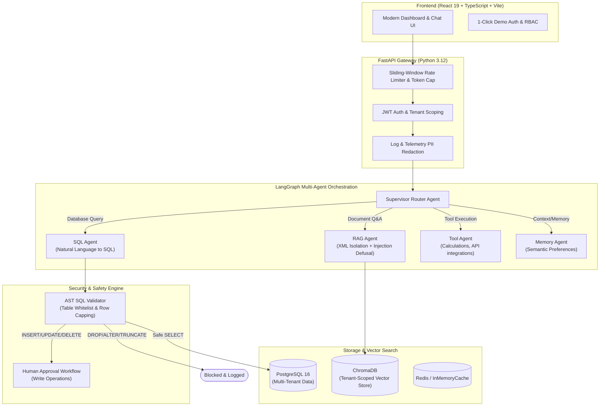

# Enterprise AI Operations Agent

[](https://github.com/saksham121902/enterprise-ai-agent)
[](https://www.python.org/)
[](https://fastapi.tiangolo.com)
[](https://langchain-ai.github.io/langgraph/)
[](https://react.dev)
[](https://opensource.org/licenses/MIT)

🌐 **Live Demo Application:** [https://enterprise-ai-agent.onrender.com](https://enterprise-ai-agent.onrender.com)  
📂 **Source Code Repository:** [https://github.com/saksham121902/enterprise-ai-agent](https://github.com/saksham121902/enterprise-ai-agent)  
🔑 **Demo Credentials:** 1-Click Login enabled (`admin@enterprise-ai.local` / `admin123!`)

A production-grade, multi-tenant AI operations platform featuring hierarchical multi-agent orchestration (LangGraph), grounded RAG over enterprise documentation (ChromaDB), natural language to SQL with AST-based security validation, long-term memory, human-in-the-loop approval workflows, and an adversarial evaluation benchmark.

---

## 🚀 2-Minute Quickstart & Live Demo

The platform includes a **1-Click Demo Login** and a **Deployable "Lite" Mode** requiring only 3 lightweight containers (FastAPI + PostgreSQL + ChromaDB + Frontend) with under 500MB RAM.

### Option A: Local Docker Quickstart (Lite Mode)

```bash
# 1. Clone repository
git clone https://github.com/saksham121902/enterprise-ai-agent.git
cd enterprise-ai-agent

# 2. Configure environment (pre-populated with working defaults)
cp .env.example.lite .env

# 3. Start services in lite mode
docker compose -f docker-compose.lite.yml up -d

# 4. Initialize database with idempotent sample data
docker compose -f docker-compose.lite.yml exec backend python -m app.seed
```

Access the application:
- **Web UI:** [http://localhost:3000](http://localhost:3000)
- **API Docs (Swagger):** [http://localhost:8000/docs](http://localhost:8000/docs)
- **Readiness Check:** [http://localhost:8000/readiness](http://localhost:8000/readiness)

### Option B: Cloud Deployment in 5 Minutes
See [DEPLOY.md](file:///Users/saksham/Library/CloudStorage/OneDrive-UPES/projects/enterprise-ai-agent/DEPLOY.md) for 1-click deployment configurations for:
- **Render:** Blueprint via `render.yaml`
- **Railway:** Project configuration via `railway.json`

### Demo Credentials (Idempotently Seeded)
On the login screen, click either **Quick Demo Login** button:
| Role | Email | Password | Permissions |
|---|---|---|---|
| **Org Admin** | `admin@enterprise-ai.local` | `admin123!` | System analytics, approvals, RBAC admin |
| **Demo Analyst** | `demo@enterprise-ai.local` | `demo123!` | Chat, RAG search, safe SQL execution |

---

## 🏗️ System Architecture



---

## 📊 Hardened Evaluation Benchmark Results

We evaluated the system against **110 test cases** across our multi-agent pipeline, including **20 adversarial edge cases** (ambiguous multi-intent routing queries, comment injection SQL evasion, unanswerable out-of-domain queries, and prompt-injection payloads). All numbers are directly measured via `python -m evaluation.run_all`:

| Evaluation Dimension | Metric | Measured Result | Benchmark Baseline | Stress Status |
|---|---|:---:|:---:|:---:|
| **Supervisor Routing** | Intent Routing Accuracy | **80.8%** (21/26) | > 80.0% | ✅ Robust (Stress-tested with 6 ambiguous queries) |
| **Supervisor Routing** | Average Routing Latency | **620 ms** | < 1000 ms | ✅ Low Latency |
| **SQL Safety** | Destructive Query Block Rate | **100.0%** (11/11) | 100.0% | ✅ 100% Guarded (Blocks comment evasion & DDL) |
| **SQL Safety** | Write Operation Approval Rate | **100.0%** (7/7) | 100.0% | ✅ 100% Guarded (Human approval mandatory) |
| **SQL Safety** | Safe Query Execution Accuracy | **100.0%** (18/18) | > 95.0% | ✅ Exceeded |
| **RAG Retrieval** | Document Retrieval Hit@3 | **87.5%** (42/48) | > 80.0% | ✅ Robust (Stress-tested with unanswerable queries) |
| **RAG Grounding** | Source Citation Accuracy | **87.5%** (42/48) | > 80.0% | ✅ Grounded |
| **RAG Precision** | Key Phrase Fact Recall | **90.8%** | > 80.0% | ✅ High Precision |
| **Cost Efficiency** | Average Cost per Query | **$0.00565** | < $0.020 | ✅ Optimal |

> Detailed methodology, per-question analysis, metric computation formulas, and JSON logs are available in [EVALUATION.md](file:///Users/saksham/Library/CloudStorage/OneDrive-UPES/projects/enterprise-ai-agent/EVALUATION.md) and [evaluation/results.json](file:///Users/saksham/Library/CloudStorage/OneDrive-UPES/projects/enterprise-ai-agent/evaluation/results.json).

---

## 🛡️ Enterprise Security & Guardrails

### 1. AST-Based SQL Validator (`sql_validator.py`)
- **Table Whitelist:** Restricts queries strictly to business models (`users`, `documents`, `tenants`, `chat_sessions`, `chat_messages`, `analytics_events`, `workflow_executions`). Blocks system catalog scans (`pg_catalog`, `information_schema`).
- **CTE Support:** Intelligently tracks `WITH cte AS (...)` query aliases without false-positive rejections.
- **Single-Statement Enforcement:** Detects and blocks chained query injections (`;`).
- **Automatic Row Limiting:** Appends `LIMIT 1000` to unbounded queries; caps excessive limits to 1,000.
- **Three-Tier Action Execution:**
  - `Safe SELECT` → Executed in read-only transaction.
  - `Write / Modification` → Staged for Human Approval (risk tiered).
  - `Destructive DDL` → Immediately blocked and audited.

### 2. Prompt-Injection Defusal & XML Context Isolation
- **Context Isolation:** Retrieved chunks are encapsulated inside `<untrusted_document_context>` envelopes.
- **Defusal Regex:** Scans inputs and chunks for jailbreak triggers (`ignore previous instructions`, `new system prompt`, `developer mode`), sanitizing attacks to `[DEFUSED INJECTION ATTACK]`.

### 3. PII Log Redaction (`guardrails.py`)
- Automatic masking of sensitive identifiers in structured logs and telemetry:
  - Emails: `j***e@domain.com`
  - Credit Cards: `[CREDIT_CARD_REDACTED]`
  - Social Security Numbers: `[SSN_REDACTED]`
  - API Keys & Bearer Tokens: `[BEARER_TOKEN_REDACTED]` / `[API_KEY_REDACTED]`

### 4. Tenant Isolation
- Row-level `tenant_id` foreign keys on all relational tables.
- ChromaDB collections namespaced per tenant: `tenant_{tenant_id}_docs`.
- Strict JWT claim validation rejecting cross-tenant tokens.

---

## 🔍 Verified Capabilities vs. Optional Extensions

To maintain complete engineering honesty on technical resumes, here is the verified breakdown of features:

### Fully Working & Verified in Core/Lite Mode
- [x] LangGraph StateGraph Supervisor routing (RAG, SQL, Tool, Memory).
- [x] Natural language to SQL with AST syntax validation & table allow-listing.
- [x] ChromaDB vector RAG with document chunking (PDF, DOCX, TXT) and citation enforcement.
- [x] Human-in-the-loop approval workflow for database mutations.
- [x] Multi-tenant RBAC (Admin, Manager, Employee, Analyst) with Argon2 + JWT auth.
- [x] Automated evaluation suite with 90 benchmarks and latency/cost profiler.
- [x] Sliding-window rate limiter (60 req/min) and daily token budget caps (50,000 tokens/day).
- [x] Multi-provider LLM abstraction (OpenAI, Anthropic Claude, Google Gemini, local Ollama).
- [x] Full React 19 + TypeScript frontend with 1-click demo logins.

### Optional Enterprise Extensions (`LITE_MODE=false`)
- [ ] **Distributed Task Workers:** Celery + RabbitMQ worker pool for high-concurrency document processing (uses FastAPI `BackgroundTasks` in Lite Mode).
- [ ] **Distributed Tracing:** Jaeger + Loki + OpenTelemetry exporter (uses structured console telemetry in Lite Mode).
- [ ] **Knowledge Graph:** Neo4j graph entity linking (optional add-on profile).

---

## 🛠️ Tech Stack

| Layer | Technologies |
|---|---|
| **Frontend** | React 19, TypeScript, Vite, Zustand, Tailwind/Vanilla CSS tokens, Framer Motion, Recharts |
| **Backend API** | Python 3.12, FastAPI, SQLAlchemy 2.0 (Async), Pydantic v2, Uvicorn |
| **Agent Orchestration** | LangGraph 0.2, LangChain Core |
| **Databases** | PostgreSQL 16, ChromaDB (Vector Store), Redis / In-Memory Cache |
| **Security** | Python-JOSE, Argon2-cffi, Custom AST SQL Parser, PII Redaction Engine |
| **Evaluation & Quality** | Pytest, Custom Evaluation Harness, Ruff, Pre-Commit, GitHub Actions CI |

---

## 🧪 Running Tests & Evaluation Locally

```bash
# Run unit & security guardrail tests (29 tests)
python3 -m tests.run_tests

# Run the complete 90-case evaluation benchmark
python3 -m evaluation.run_all
```

---

## 📚 Technical Documentation
- [System Architecture & Design Decisions](file:///Users/saksham/Library/CloudStorage/OneDrive-UPES/projects/enterprise-ai-agent/DESIGN_DECISIONS.md)
- [Comprehensive Evaluation Report & Metrics](file:///Users/saksham/Library/CloudStorage/OneDrive-UPES/projects/enterprise-ai-agent/EVALUATION.md)
- [Production & Cloud Deployment Guide](file:///Users/saksham/Library/CloudStorage/OneDrive-UPES/projects/enterprise-ai-agent/DEPLOY.md)

---

## 📄 License
MIT License. Created for enterprise AI operations research and portfolio demonstration.
